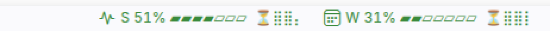

# claude-usage-statusbar

VSCodium extension that shows **Claude Code usage** in the status bar — **Session** (5h) and
**Weekly** (7d) windows, each as a **percentage** with a **color‑coded progress bar**. The numbers
are the **real** values from Anthropic's usage endpoint (the same data Claude Code's `/usage` screen
shows), not a local estimate. No npm dependencies.



*Session 51 % and Weekly 31 % with their progress bars and "resets in" sand-timer gauges (v0.7.0, live).*

Full design rationale, mockups, and color thresholds:
[`ClaudeCode_usage_snippet_for_VSCodium.md`](ClaudeCode_usage_snippet_for_VSCodium.md).

## How it gets the data

It reads your Claude Code OAuth token from `~/.claude/.credentials.json` and calls
`GET https://api.anthropic.com/api/oauth/usage` — exactly the read‑only call Claude Code makes to
draw `/usage`. The token is read locally and sent **only** to `api.anthropic.com`. The response gives
`five_hour.utilization` (Session %) and `seven_day.utilization` (Weekly %) plus `resets_at`.

> The token is refreshed by Claude Code itself; this extension never writes credentials. If the token
> is expired (and Claude Code isn't running to refresh it), the items show `—` with a tooltip telling
> you to open Claude Code / run `/usage`.

## Files

| File | Purpose |
|------|---------|
| `extension.js` | The extension: fetch usage, render two status‑bar items. |
| `package.json` | Manifest + `claudeUsage.*` settings + `claudeUsage.refresh` command. |
| `verify-harness.js` | Standalone Node script — calls the same endpoint and prints what the extension will show. No VSCodium needed. |

## Install

```bash
cp -r claude-usage-statusbar ~/.vscode-oss/extensions/
```

Then run **Developer: Reload Window** in VSCodium. Two items appear at the bottom‑right.

Or build a `.vsix`:

```bash
cd claude-usage-statusbar
npx @vscode/vsce package
# VSCodium → Extensions: Install from VSIX…
```

## Configure

Settings → Extensions → **Claude Code Usage** (keys `claudeUsage.*`):
`refreshBaseSeconds` (default 90, ±`refreshJitterPct` 20 %, min 15), backoff
(`backoffMedianFirstSeconds` 2 / `backoffCapSeconds` 300), activity sync (`syncToActivity`,
`activityDebounceSeconds`, `activityMinIntervalSeconds`), `barSegments`, color thresholds
(`warnThreshold` 60 / `highThreshold` 80 / `criticalThreshold` 95). `credentialsPath` and `betaHeader`
are machine-scoped: set them in user settings, a workspace's `.vscode/settings.json` cannot override them.

> v0.7.0 removed `refreshIntervalSeconds`, `backoffBaseSeconds` and `timeWarnPct`/`timeHighPct`/`timeCritPct`
> (they had stopped having any effect). Use `refreshBaseSeconds` / `backoffMedianFirstSeconds` instead.

## Verify (no editor needed)

```bash
node verify-harness.js
# or, using the Node runtime bundled with VSCodium:
ELECTRON_RUN_AS_NODE=1 /usr/share/codium/codium verify-harness.js
```
